# sketchflow

**Status: v0.1.** Small and young: the flow format may still change before
1.0. See [CHANGELOG.md](CHANGELOG.md).

Step-by-step animated flows over the Excalidraw diagrams you already have.
Write a short YAML file that says what happens, step by step: a caption,
the hops a message takes between boxes, where the camera zooms, and notes
that type themselves out. sketchflow compiles it into **one animated SVG**,
and makes everything else from that SVG:

| Output | For |
| --- | --- |
| `svg` | READMEs and docs: plays in an ``, vector, small, real text |
| `html` | reading at your own pace: play, pause, step back and forth, scrub |
| `mp4` | Slack, chat, slides (H.264, ffmpeg) |
| `webm` | the web's `<video>`, smaller than mp4 (VP9, ffmpeg) |
| `gif` | anywhere else an image goes (gifski when installed, else ffmpeg) |



The diagram is never redrawn. sketchflow reads your `.excalidraw` file for
where every box and arrow is, exports it with Excalidraw's own exporter,
and lays the animation over it, so a flow follows its diagram when the
layout changes.

## Quick start

```sh
npm install --save-dev github:highfivelabs/sketchflow
npx sketchflow examples/deploy/deploy.flow.yaml --formats svg,html,mp4,webm,gif
```

It needs Node 20+, Chrome or Chromium (an installed Google Chrome, or
`--chrome <path>`, or `SKETCHFLOW_CHROME`), and ffmpeg for `mp4`, `webm`
and `gif`. [gifski](https://gif.ski) is optional: when it is on the PATH,
GIFs are encoded with it (better colour across frames); otherwise ffmpeg's
`palettegen`/`paletteuse`. `--gif-encoder gifski|ffmpeg` picks one.

```
sketchflow <flow.yaml>... [--formats svg,html,mp4,webm,gif] [--out <dir>]
           [--chrome <path>] [--gif-encoder gifski|ffmpeg]
```

## A flow

```yaml
scene: deploy.excalidraw          # the diagram, relative to this file
title: "Merge to running: a new image, followed by its digest"
formats: [svg, html, mp4, webm, gif]  # default svg, html
draw: true                        # optional: draw the diagram in first
steps:
  - caption: A developer merges a pull request that changes the app.
    focus: [developer]            # lit; everything else is dimmed
  - zoom: [g-forge]               # the camera fits these shapes; `all` zooms out
    caption: CI builds the image and tags it with the commit.
    flows:
      - {path: [developer, ci], label: "push main@3f9a2c1d"}
    write:
      - {at: ci, side: bottom, text: "docker build -t app:3f9a2c1d ."}
  - caption: CI pushes the image. The registry stores it by its digest.
    flows:
      - {path: [ci, registry], label: "app:3f9a2c1d"}
    badges:
      - {at: registry, text: "sha256:9b1c…"}
```

Shapes are named by their **label** (the text in them, or its first line,
any case) or by their Excalidraw **element id**.

### Everything a step can say

| Key | Meaning |
| --- | --- |
| `caption` | What happens, a sentence or two. Types itself out in the caption bar. |
| `zoom` | Shapes (or `all`) the camera fits, easing there over 0.9 s. It stays until a later step moves it. `zoomPad` (default 50) is the room around them. |
| `focus` | Shapes to light; the rest dims. Default: every shape a flow, badge or note names. |
| `flows` | Tokens, one after another. `path` is two or more shapes; `label` rides with the token; `color` (default red). A hop follows the arrow drawn between its shapes, either way round; with no arrow, `via: [[x, y], ...]` bends (scene coordinates), or else a straight line. |
| `badges` | Labels that appear once the flows are done: `at` a shape, `text`, `side` (`bottom`, `top`, `left`, `right`). |
| `write` | Text that types itself out in the diagram's font: `at` a shape (with `side`) or `[x, y]`, `text`, `size`, `color`, `when: start` (default after the flows), `keep: true` to stay to the end of the loop. |
| `seconds` | At least this long (default 3); a step always lasts long enough for its camera, flows, notes and caption, plus a pause. |

And for the whole flow:

| Key | Meaning |
| --- | --- |
| `scene` | The `.excalidraw` file, relative to the flow. Required. |
| `title` | Shown above the captions. |
| `output` | File name without extension; default the flow's. |
| `formats` | Any of `svg`, `html`, `mp4`, `webm`, `gif`; default `svg`, `html`. `--formats` overrides it. |
| `draw` | `true` (3 s) or seconds: before the first step, the diagram draws itself in, element by element, strokes along their length and fills and text faded in (the idea of [excalidraw-animate](https://github.com/dai-shi/excalidraw-animate), done in SMIL on the exported SVG). |
| `typing` | Caption characters a second, default 55; 0 shows it at once. |
| `writing` | Note characters a second, default 28. |
| `fps` | Frames a second grabbed for mp4, webm and gif, default 12. |
| `mp4`, `webm` | `{width}`, default 1600. |
| `gif` | `{width, fps}`, default 1100 and 8. |

## How it works

1. **Export.** Excalidraw's exporter (`@excalidraw/utils`) turns the scene
   into an SVG, in headless Chrome. Excalidraw embeds only the glyphs a
   scene uses, so sketchflow adds an invisible text element carrying the
   flow's own characters first.
2. **Timeline.** The flow becomes a timeline: each step's start and end,
   the camera, each token's path and timing, each badge and note.
3. **Compile.** The timeline is written into the SVG as SMIL animations.
   Every animation spans the whole loop with its own key times, so the
   SVG has one clock: pausing it and setting its time
   (`pauseAnimations`, `setCurrentTime`) shows exactly that moment.
4. **Everything else from the SVG.** The HTML player is the SVG with
   controls on its own clock. MP4, WebM and GIF are frames of the SVG, set to
   each frame's time in headless Chrome and encoded by ffmpeg (or, for
   GIF, gifski).

The diagram sits in a clipped group rather than a nested `<svg>`, because
browsers give a nested `<svg>` a clock of its own that the outer one does
not move.

## Limits

- A token follows an arrow's points with straight segments. An Excalidraw
  arrow drawn curved through several points is approximated; draw it with
  sharp corners where the path matters.
- Shapes are found by label or id; a label on two shapes is an error,
  so use the element id there.
- `draw` draws Excalidraw's exported strokes in z-order; it does not
  reproduce the hand's stroke order, and dashed strokes fade in rather than
  draw.
- Rendering needs Chrome; the video formats need ffmpeg, which is not
  bundled.
- SMIL plays in every current browser and in GitHub's markdown. Some chat
  apps do not show SVG images; use the MP4, WebM or GIF there.

## Prior art

[excalidraw-animate](https://github.com/dai-shi/excalidraw-animate) animates
a diagram being drawn, stroke by stroke. [Excalidraw Claymate](https://github.com/dai-shi/excalidraw-claymate)
makes stop-motion GIFs from scenes edited by hand. [D2](https://d2lang.com),
[Motion Canvas](https://motioncanvas.io), [Manim](https://www.manim.community)
and [Remotion](https://www.remotion.dev) animate pictures drawn in their own
terms. sketchflow animates a flow *over* an existing Excalidraw diagram,
from a short script.

## License

Apache-2.0. Copyright 2026 High Five Labs.
